# Practice work #12 – Compare code-based and low-code solutions

**Student:** [your full name] · **ID:** [your ID] · **Class:** [day of week, time]
**Date:** 24 November 2026
**Scenario:** Smart Campus Room Availability Checker – one fictional room (A101)

| | Code-based | Low-code |
|---|---|---|
| Platform | Bolt.new project `sb1-55dv1cdr` (React 18 + TypeScript + Vite + Vitest) | Appsmith Cloud, free plan, app "Smart Campus A101 Low-code" |
| Live demo | https://smart-campus-room-av-6yo1.bolt.host/#contract | https://app.appsmith.com/app/smart-campus-a101-low-code/page1-6b0548aab9542a02bf24e0db (see note in 10.3: must be switched to public) |
| Source / export | https://github.com/alukaw/smart-campus-room-checker – code commit `a620a43`; report, contract and screenshots in `docs/practice12/` (commits `e5711fa`, `918e058`, `15a22c7`) | JS object `docs/practice12/lowcode/AvailabilityRules.js`, manifest `lowcode/WIDGETS.md`; full JSON via *Export application* |
| AI tools | Bolt.new built-in agent (Standard mode, model not shown) | Claude Opus 5.5 (Anthropic) through Claude in Chrome – also used for the whole practice (see section 12) |

No subscription was bought. All data is fictional.

---

## 0. Summary

I implemented the same small feature twice from one shared contract (6 acceptance criteria, 8 test cases): once in my existing Bolt/React project and once in Appsmith. **Both solutions passed 8 of 8 tests** in the browser. The code-based solution also has 22 automated tests for the contract (80 of 80 tests in total, type check, lint and build pass). Measured effort was similar (about 16 min vs 20 min), but the low-code version needed a layout repair for narrow screens, has no real test runner, no Git history and a platform-specific export. My recommendation is to keep the **code-based solution as the main implementation** and use the low-code tool only for quick internal prototypes (section 9).

---

## 1. Task 01 – Freeze the baseline

| Item | Value |
|---|---|
| Version | Bolt Version 20 = GitHub commit `93f4ef8` (21 Nov 2026) |
| Booking data | `src/data.ts`: 6 fictional rooms (B201 blocked), 6 bookings; room A101 has 10:00–11:00 (Dr. Smith) and 12:00–13:00 (Prof. Lee) |
| Expected behaviour | `checkAvailability()` in `src/availability.ts` is the single source of truth: invalid input → out of range → start ≥ end → past time (≤ 09:00) → longer than 120 min → no room → blocked → overlap (touching allowed) → available |
| Checks run 24 Nov 13:15 in the Bolt terminal | `npm test` 4 files, **58/58 passed**; `npm run typecheck` exit 0; `npm run lint` exit 0 (warning: TypeScript 5.6.3 is newer than the range supported by @typescript-eslint); `npm run build` exit 0, built in 1.62 s |

The booking rules were **not changed** for this practice. Both solutions use the same rules and the same A101 fixtures.

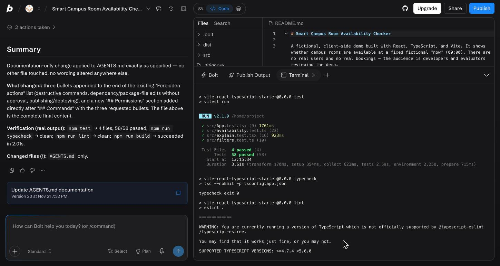
*Figure 1. Baseline: 58/58 tests, type check exit 0 (Version 20).*

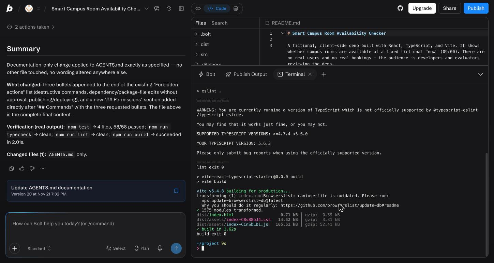
*Figure 2. Baseline: lint exit 0, build exit 0.*

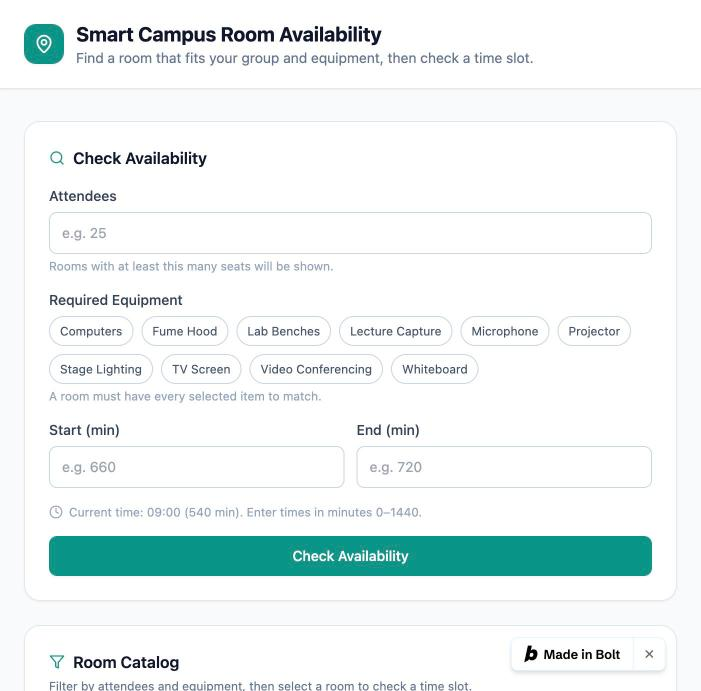
*Figure 3. Published baseline app before the change (only the "Room finder").*

---

## 2. Task 02 – Common contract

The full sheet is in [`CONTRACT.md`](CONTRACT.md). It was written before any implementation and was given to both solutions unchanged.

**User story.** As a student, I want to choose a future start time and a duration for the fictional room A101 and immediately see Available or Unavailable with a clear reason, so that I can plan a study session without changing any existing bookings.

| ID | Acceptance criterion |
|---|---|
| AC1 | Start time must be in the future (after 09:00). |
| AC2 | Duration must be > 0 and ≤ 120 minutes. |
| AC3 | Overlapping bookings are unavailable (touching endpoints are allowed). |
| AC4 | Blocked room is unavailable. |
| AC5 | Display a clear decision without changing existing bookings. |
| AC6 | Invalid input receives understandable feedback. |

- **Inputs:** `startTime` (HH:MM), `durationMinutes` (whole number), `blocked` (boolean room-status control), fictional `bookings` (read-only).
- **Outputs:** `available` (boolean), `reasonCode` (INVALID_START, INVALID_DURATION, ENDS_AFTER_DAY, PAST_START, BLOCKED, OVERLAP, AVAILABLE), visible `message` with exact wording, checked in this order.
- **Test inputs T1–T8** were fixed before implementation (table in section 5).

---

## 3. Task 03 – Code-based solution (Bolt.new)

**Prompt** (based on the suggested implementation prompt; full text in section 12): "Read the root AGENTS.md first and follow it. Act as a software engineering assistant. Implement the Smart Campus availability contract … Keep all six acceptance criteria unchanged. Use fictional data only. Separate deterministic booking rules from presentation. Explain limitations and provide tests. Do not invent successful test results." + the contract, the list of allowed files and "tests first".

**Result: Bolt Version 21 = commit `a620a43`** (5 files, +624/−3 lines):

| Layer | File | What it does |
|---|---|---|
| Validation | `src/contract.ts` – `parseStartTime()`, `validateContractInput()` | HH:MM parsing, duration 1–120, ends by 24:00, start after 09:00 |
| Availability calculation | `src/contract.ts` – `checkContract()` | builds a **copy** of room A101 with the `blocked` flag and delegates the decision to the existing `checkAvailability()` (single source of truth); maps its codes to the 7 contract codes |
| UI display | `src/components/ContractChecker.tsx` | time input, number input, "Room blocked for maintenance" checkbox, "Check A101" button, result box with `role="status"`, read-only bookings list; Tailwind grid `grid-cols-1 sm:grid-cols-2` for narrow screens |
| Tests | `src/contract.test.ts` (16), `src/components/ContractChecker.test.tsx` (6) | T1–T8 by name + extra cases (malformed time, 23:30/60, exactly 120 min, ordered checks) and UI tests for T1, T3, T4 |
| Wiring | `src/App.tsx` | two tabs "Room finder" (unchanged default) and "Single-room checker"; `#contract` opens the new tab |

**Process evidence (agent report, then my own checks):** the agent first ran the new tests against no implementation (both files failed with "Failed to resolve import"), then implemented. It then had 2 failing UI tests (its own test mistakes) and 4 type errors, and fixed them itself (Figure 4a). Final agent output: 80/80, type check and lint clean, build 2.04 s. I did **not** accept this on trust:

- Bolt terminal, 13:32: `npx vitest run --reporter=verbose src/contract.test.ts` → 16/16 with T1–T8 listed by name (Figure 4); `npm test` → 6 files **80/80**, type check / lint / build exit 0 (Figure 5).
- Independent clean clone of `a620a43` in a separate Linux workspace (Node v22.23.5, `npm ci`): 80/80, type check, lint, build exit 0 (built in 2.06 s).
- I read the full diff. All 58 old tests passed without changes; `src/data.ts` and `package.json` were not touched.

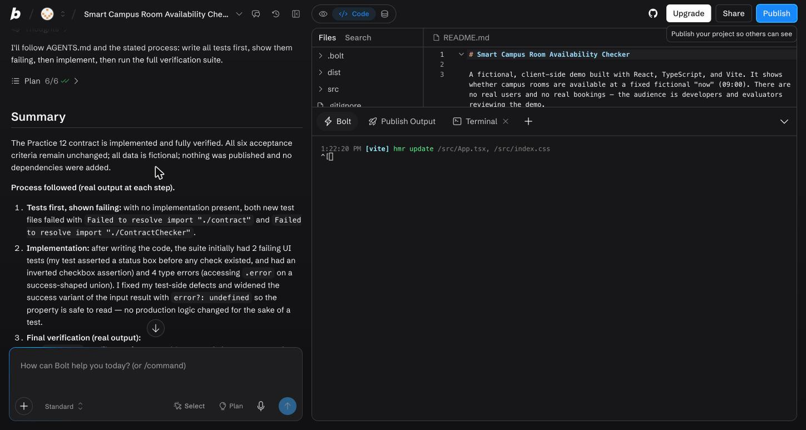
*Figure 4a. Bolt agent summary for Version 21: tests written first and shown failing, then implementation; the agent's own test and type errors are disclosed.*

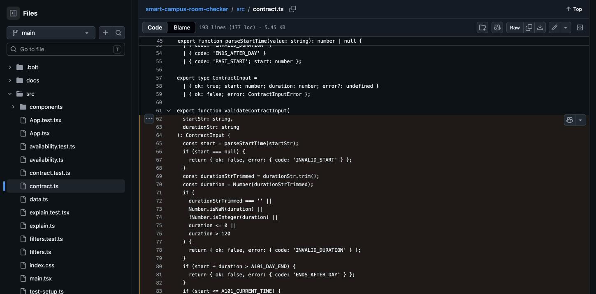
*Figure 4b. Code evidence – validation layer `validateContractInput()` in `src/contract.ts` (GitHub, commit `a620a43`).*

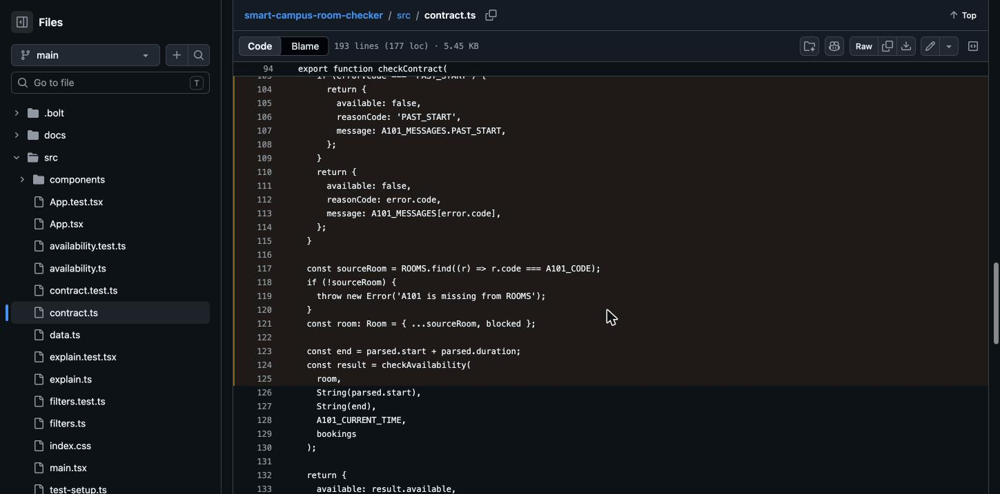
*Figure 4c. Code evidence – calculation layer `checkContract()`: a copy of room A101 with the `blocked` flag, decision delegated to the existing `checkAvailability()`.*

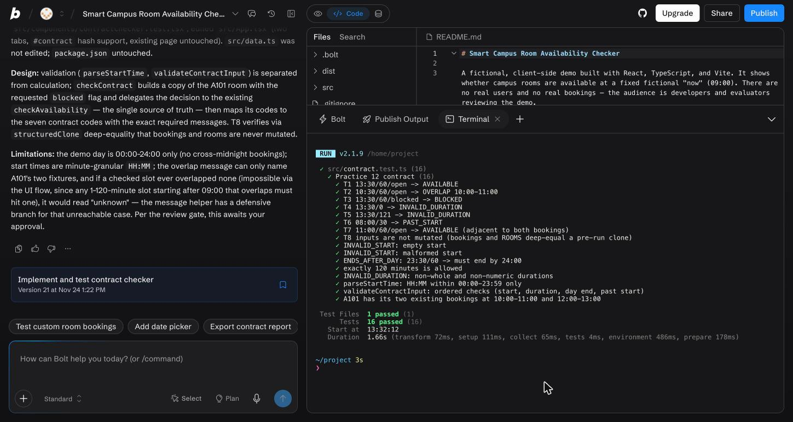
*Figure 4. Code-based contract tests T1–T8 (16/16) in the Bolt terminal.*

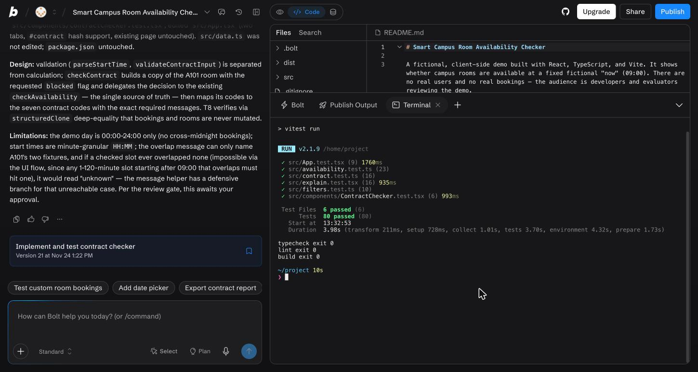
*Figure 5. Version 21: 80/80 tests, type check, lint and build exit 0.*

Published (after my approval) to the same site; the new view is at `/#contract` (Figure 6, and Figures 10–17 for the running result).

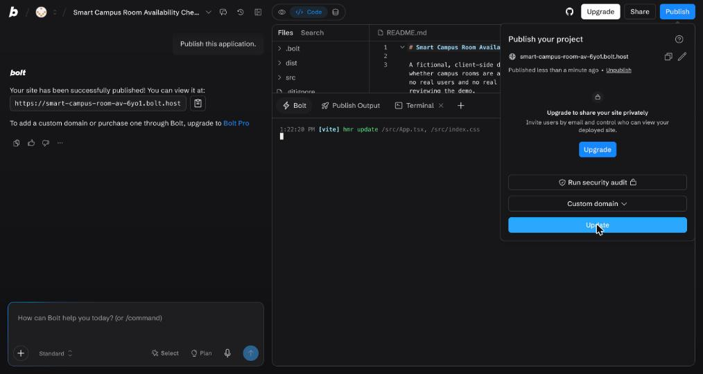
*Figure 6. Bolt: "Your site has been successfully published" for Version 21.*

**Code review notes (mine):**

- CR1 (low): `formatHHMM()` in `contract.ts` duplicates the existing `formatTime()`.
- CR2 (low): `buildMessage()` repeats the overlap condition to find which booking to name in the message; the decision itself still comes from `checkAvailability()`.
- CR3 (low, UX): after the user changes an input, the old result stays visible until "Check A101" is pressed again (Figure 18). The same behaviour exists in the low-code version.

---

## 4. Task 04 – Low-code solution (Appsmith)

**Setup:** I created a free Appsmith Cloud account with "Sign in with GitHub" (OAuth scope: read-only profile, `read:user`) and skipped the datasource step, because the contract needs no database.

**Implementation:**

1. JS object `AvailabilityRules` (98 lines, [`lowcode/AvailabilityRules.js`](lowcode/AvailabilityRules.js)) with the same fictional bookings, `validate()` (validation layer), `decide()` (calculation layer), `evaluate()`, `check()` (UI glue), `bookingRows()` and `runContractTests()`.
2. Nine widgets (manifest in [`lowcode/WIDGETS.md`](lowcode/WIDGETS.md)): title, StartInput (text, HH:MM), DurationInput (Number), BlockedSwitch (room status), CheckButton, ResultText (status, message, reason code, colour bound to status), BookingsTable (read-only), SelfTestButton, SelfTestTable.
3. CheckButton onClick was set with the **visual action selector** ("Execute a JS function → AvailabilityRules.check"), Figure 7. Display bindings are platform expressions `{{ … }}` (Figure 8).
4. Deployed with "Deploy".

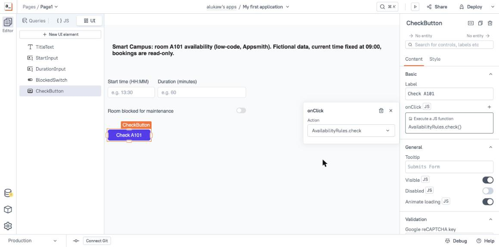
*Figure 7. Appsmith: onClick configured visually.*

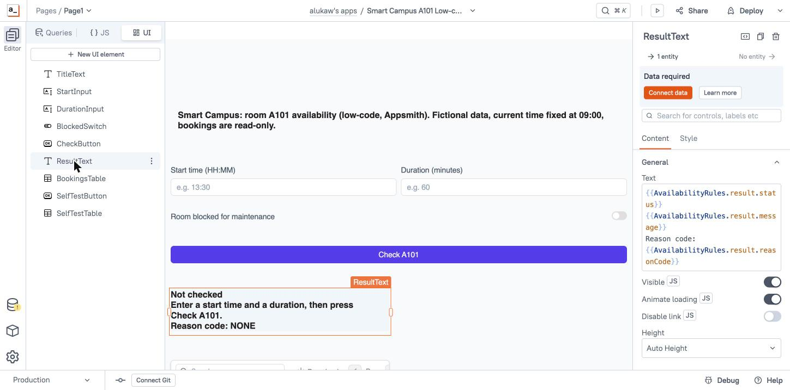
*Figure 8. Appsmith widget tree and the ResultText binding.*

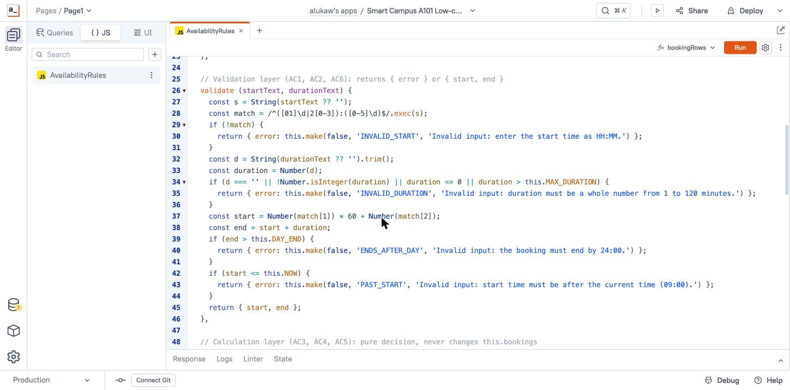
*Figure 9. Appsmith JS object – the validation layer.*

**Requirements the platform could not implement visually (clearly labelled):**

| Requirement | What happened |
|---|---|
| Overlap check, ordered reason codes, exact messages | Not possible with widget properties only; implemented as a **small script** (JS object). |
| Automated tests (T1–T8) | Appsmith has no built-in unit-test runner. **Workaround:** "Run T1-T8 self-test" button that re-runs the cases through the same `evaluate()` inside the app. This is not equivalent to CI tests. |
| Fictional booking store | **Simulated** as a static JS array (no datasource, nothing is written). |
| Fixed "now" 09:00 | **Simulated** constant (same as the code-based version). |
| Native time picker | Not used; a text input with HH:MM validation keeps the contract identical. |
| Responsive layout | Fixed layout scales the canvas on phones; needed a manual repair (section 6). |
| Public live demo | Needs the "Make application public" switch – see 10.3. |

Note on method: the widgets were placed on the canvas by the AI agent driving the browser; Appsmith's drag-and-drop did not react to simulated mouse drags, so the agent triggered the same drag events by script. The resulting widget configuration is the normal Appsmith configuration (Figures 7–9).

---

## 5. Task 05 – Identical tests (expected and observed)

Both tested in the **deployed/published** apps on 24 Nov 2026, 13:30–13:37, desktop width.

| Test | Input | Expected | Code-based observed | Low-code observed |
|---|---|---|---|---|
| T1 | 13:30, 60, open | Available, AVAILABLE | ✅ "Available: A101 is free from 13:30 to 14:30." (Fig. 10) | ✅ same message, green (Fig. 19) |
| T2 | 10:30, 60, open | Unavailable, OVERLAP 10:00-11:00 | ✅ "Unavailable: overlaps the existing booking 10:00-11:00." (Fig. 11) | ✅ same (Fig. 20) |
| T3 | 13:30, 60, blocked | Unavailable, BLOCKED | ✅ "Unavailable: A101 is blocked for maintenance." (Fig. 12) | ✅ same (Fig. 21) |
| T4 | 13:30, 0 | Validation error, INVALID_DURATION | ✅ "Invalid input: duration must be a whole number from 1 to 120 minutes." (Fig. 13) | ✅ same, amber (Fig. 22) |
| T5 | 13:30, 121 | Validation error, INVALID_DURATION | ✅ same message (Fig. 14) | ✅ same (Fig. 23) |
| T6 | 08:00, 30 | Validation error, PAST_START | ✅ "Invalid input: start time must be after the current time (09:00)." (Fig. 15) | ✅ same (Fig. 24) |
| T7 | 11:00, 60, open | Available (adjacent) | ✅ "Available: A101 is free from 11:00 to 12:00." (Fig. 16) | ✅ same (Fig. 25) |
| T8 | after T1–T7 | bookings unchanged | ✅ list still shows only 10:00-11:00 and 12:00-13:00 (Fig. 16); unit test T8 deep-equals bookings and rooms with a `structuredClone` | ✅ table still 2 rows (Fig. 26); self-test T8 compares JSON with the original snapshot (Fig. 28) |
| **Total** | | | **8 / 8** | **8 / 8** |

One test-execution mistake (mine, not the app's): in my first T3 run on the Bolt site the page had scrolled, so the start time stayed 10:30. The result was still BLOCKED (blocked is checked before overlap), but the input did not match T3, so I re-ran T3 with 13:30 and used that screenshot.

Extra check, low-code: "Run T1-T8 self-test" shows 8 records, all `pass = true` (Figures 27–28).

### Code-based screenshots

 *Figure 10. Code-based T1.*
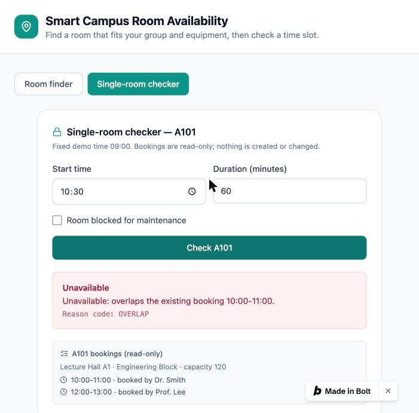 *Figure 11. Code-based T2.*
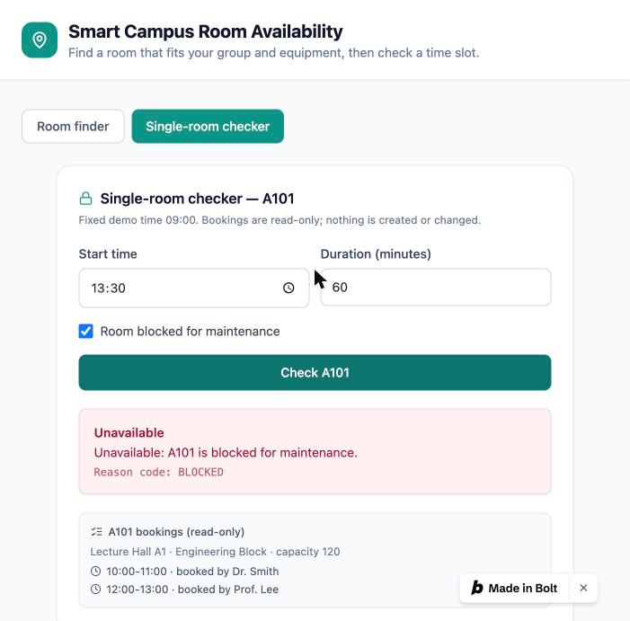 *Figure 12. Code-based T3.*
 *Figure 13. Code-based T4.*
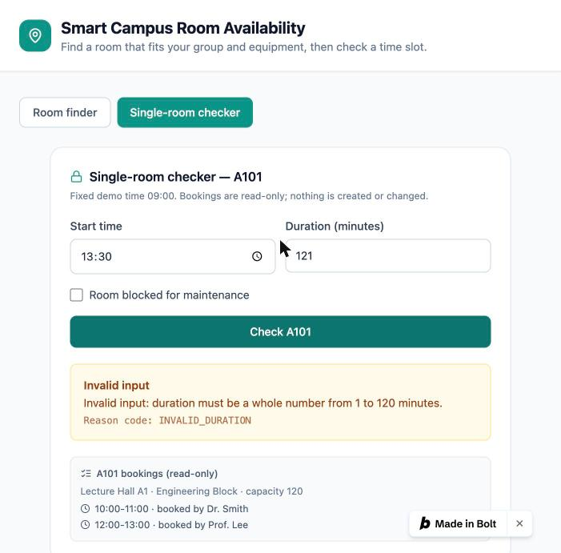 *Figure 14. Code-based T5.*
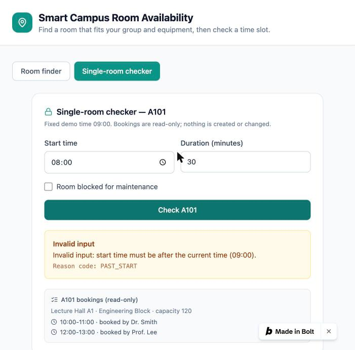 *Figure 15. Code-based T6.*
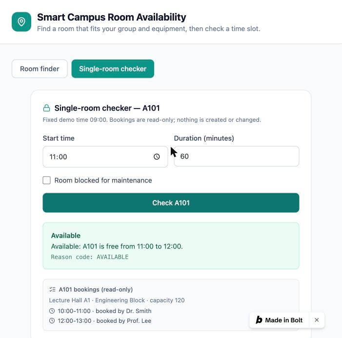 *Figure 16. Code-based T7 and T8 (booking list unchanged).*
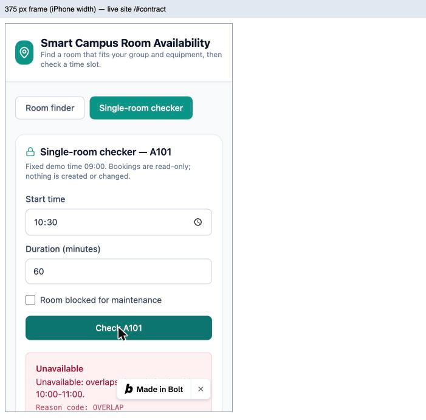 *Figure 17. Code-based at 375 px width, T2.*
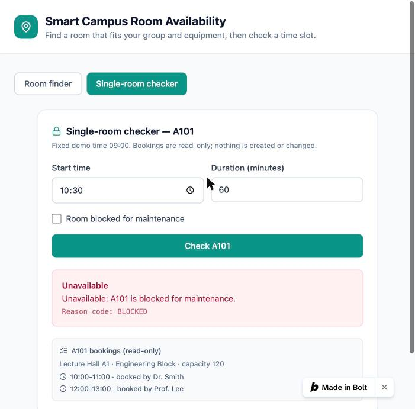 *Figure 18. CR3: checkbox already unticked, the old BLOCKED result is still shown until the next check.*

### Low-code screenshots

 *Figure 19. Low-code T1.*
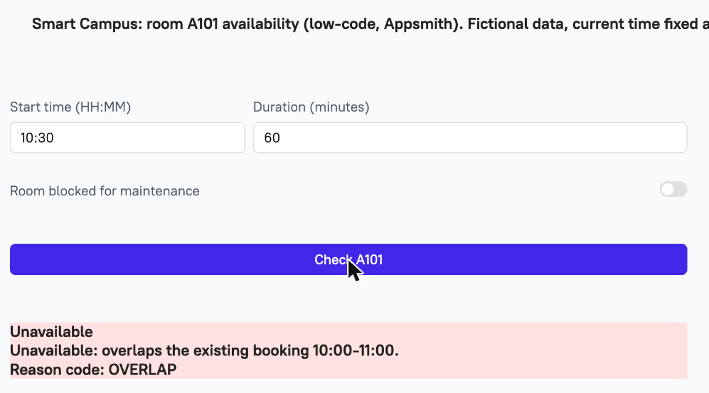 *Figure 20. Low-code T2.*
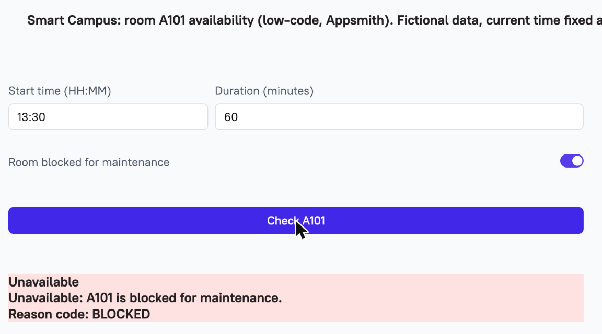 *Figure 21. Low-code T3.*
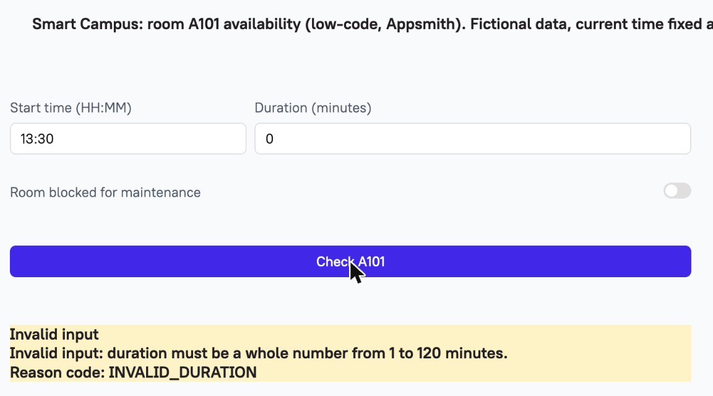 *Figure 22. Low-code T4.*
 *Figure 23. Low-code T5.*
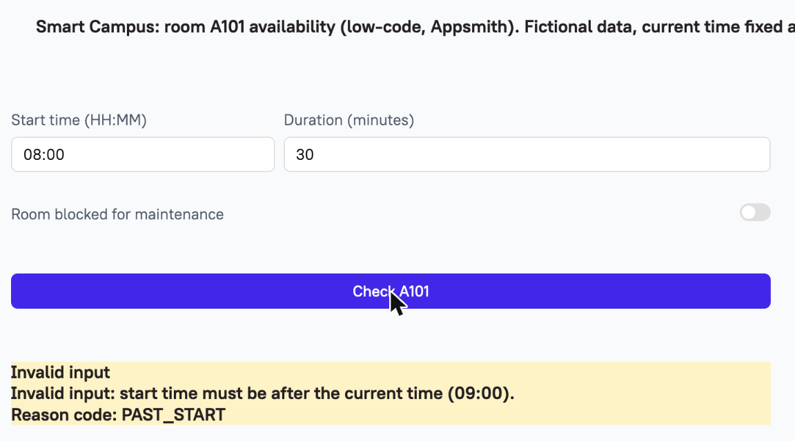 *Figure 24. Low-code T6.*
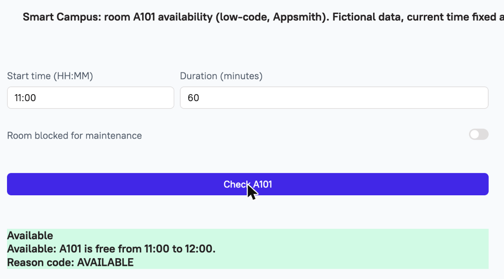 *Figure 25. Low-code T7.*
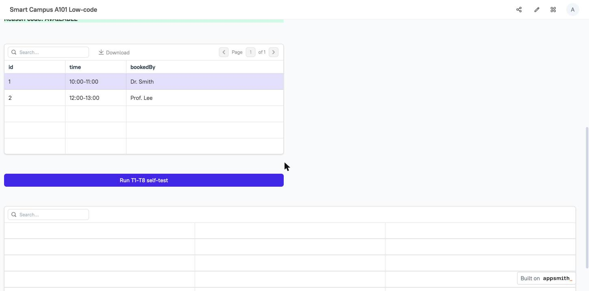 *Figure 26. Low-code T8: bookings table unchanged after T1–T7.*
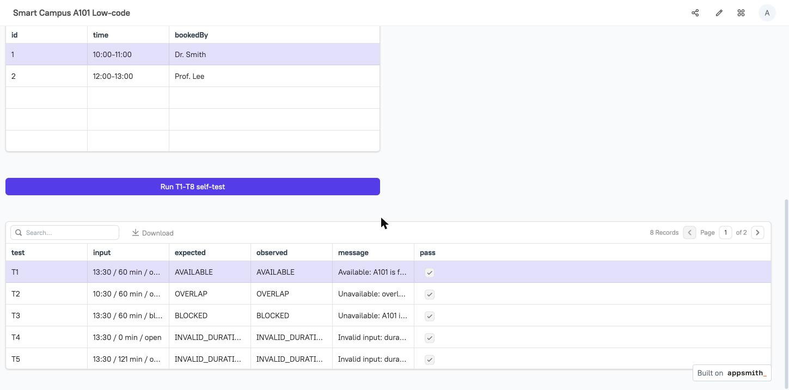 *Figure 27. Self-test T1–T5 pass.*
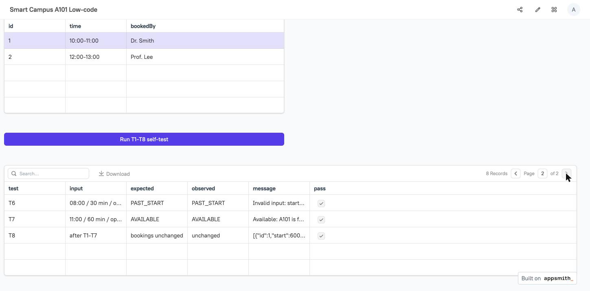 *Figure 28. Self-test T6–T8 pass.*
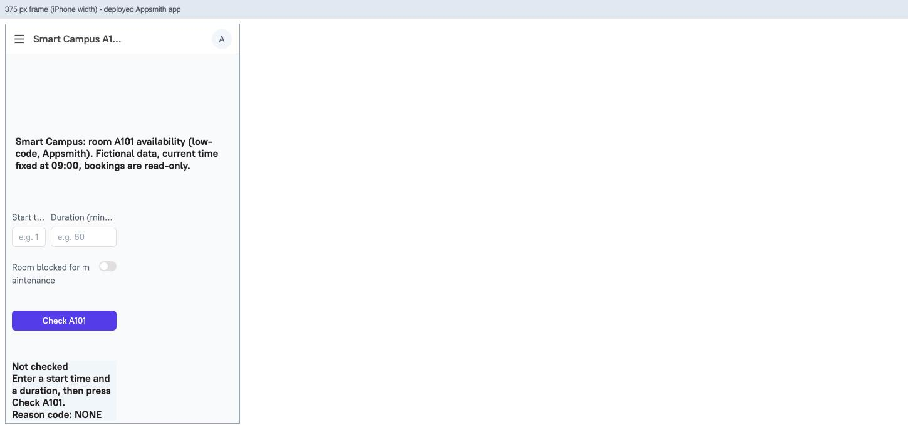 *Figure 29. Low-code at 375 px before the fix: inputs squeezed ("Start t…", "e.g. 1").*
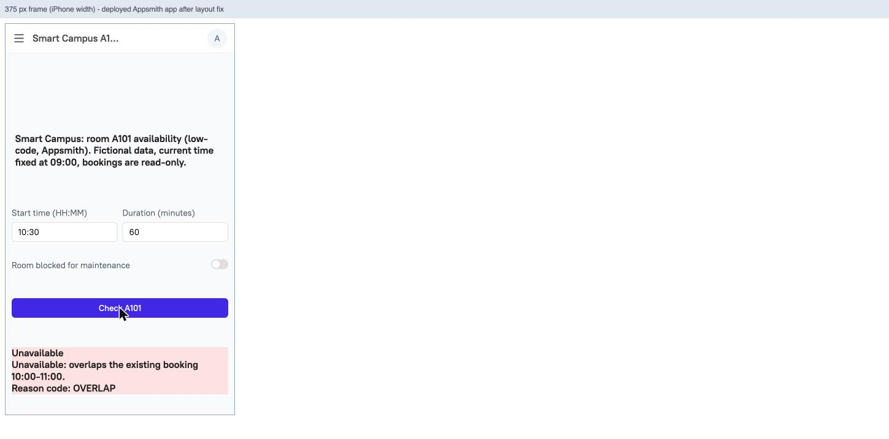 *Figure 30. Low-code at 375 px after the fix, T2.*

---

## 6. Task 06 – Engineering effort

### 6.1 Measured time (clock times from the session log, 24 Nov 2026)

| Phase | Code-based (Bolt) | Low-code (Appsmith) |
|---|---|---|
| Setup | 2.5 min (13:14:30–13:17) – open project, clone repo, baseline checks | 1.5 min (13:19:30–13:21) – GitHub OAuth sign-up, skip datasource |
| Implementation | 5 min (13:17–13:22) – prompt 1.5 min + agent run 3.7 min | 10 min (13:20:30–13:30:40) – JS object 2 min, 9 widgets + bindings + deploy 8 min (incl. 1 min undo of a misplaced table) |
| Debugging / repair | 0 min human; the agent fixed 2 own test errors and 4 type errors inside its run | ~4.5 min – start-time trim alignment (<1 min), narrow-screen layout repair 13:37:27–13:41:17 (4 min) |
| Review / testing | ~8 min – diff review + clean-clone run 2 min, terminal checks 1.5 min, live T1–T8 3 min, mobile 1 min | ~3.5 min – live T1–T8 + self-test 2 min, mobile checks 1.5 min |
| **Total** | **≈ 16 min** | **≈ 20 min** |
| Time to first working prototype | 7.5 min (13:22, Version 21) | 11 min (13:30, first deploy) |

### 6.2 Results and defects

| Measure | Code-based | Low-code |
|---|---|---|
| Acceptance tests passed (manual, deployed) | 8 / 8 | 8 / 8 |
| Automated tests | 22 new (80 / 80 in project) | none (self-test workaround, 8 / 8) |
| Unresolved defects against AC1–AC6 | 0 | 0 |
| Open lower-severity issues | 3 (CR1–CR3) + unused dependency with a known vulnerability (S6) | 2 (stale result like CR3; empty gap above the title) + rules duplicated from the code-based engine (drift risk) |

### 6.3 Review, export and version control

| | Code-based | Low-code |
|---|---|---|
| How changes are reviewed | Bolt chat summary + Git diff on GitHub (`a620a43`), tests in the same commit | Visual inspection in the editor; no diff on the free cloud app unless Git is connected |
| Version control | Git, public GitHub repo, 4 commits (`1599902`, `0fec6d6`, `93f4ef8`, `a620a43`) | Not connected ("Connect Git" exists but needs a deploy key with write access – not done, least privilege) |
| Export | Normal source code (React/Vite), builds anywhere with Node | "Export application" works: JSON 74,809 bytes, schema v13, 10 widgets, 1 JS object, 0 datasources – importable only into Appsmith |

### 6.4 Measured results vs. personal impressions

- **Measured:** the times, test counts and export size above.
- **Limitation of the measurement:** both builds were done by an AI agent (Bolt agent / Claude in the browser), not by me typing; Appsmith drag-and-drop needed scripted events. A human would be slower in both, probably more in Appsmith's visual editor at first and more in code without an agent. The code-based track also reused the engine from earlier practices, while the low-code track had to copy the rules.
- **Impression (not measured):** Appsmith is fast for simple forms and tables, but as soon as there are ordered business rules I was writing JavaScript anyway – so it behaved more like "code in a different editor" than "no code".

---

## 7. Task 07 – Security review (Lecture #12)

All checks were manual and safe, only against my own two apps. No scanners were run against bolt.host, appsmith.com or any other third-party service.

### 7.1 Security checklist

| # | Check | Code-based | Low-code |
|---|---|---|---|
| S1 | Input validation (SAST view) | PASS – one validation layer (`validateContractInput`), tested by 16 unit tests | PASS – one `validate()` function; tested only by the in-app self-test |
| S2 | Output handling / XSS (SAST) | PASS – React JSX text only; no `dangerouslySetInnerHTML`, `innerHTML` or `eval` in `src` (grep) | PASS for this app – messages never contain user text; **note:** the Appsmith Text widget can render HTML, so binding raw user text into it later would need review (not tested) |
| S3 | XSS runtime check (DAST, safe payload without alert) | PASS – `#` in the URL hash: not rendered, title unchanged; `<b>60</b>` typed into duration: the browser number field kept only "60" (Figure 31) | PASS – `<b>13:30</b>` in start time → INVALID_START, no ``/`<b>` in the DOM, title unchanged (Figure 32) |
| S4 | Injection (SQL/NoSQL) | N/A – no database, no queries | N/A – 0 datasources (export check) |
| S5 | Secrets | PASS – no keys in code; `.env` in `.gitignore` | PASS – no datasource credentials; **note:** JS objects run in the browser, so a secret placed there would be visible to every viewer |
| S6 | Dependencies (SCA view) | PARTIAL – `npm audit --omit=dev`: 1 high (`ws` 8.18.3). It comes only from the **unused** `@supabase/supabase-js` (`npm ls ws`), is not in the built bundle (grep of `dist`), but is still installed. Dev tools: 22 more (2 critical in `tinypool` via `vitest` 2.1.9, 13 high, 6 moderate, 1 low) – not shipped, but they run on developer machines. Updating needs human approval (AGENTS.md). | Platform dependencies are managed by Appsmith; I cannot list or audit them. Our responsibility is limited to the JS object and no custom JS libraries (`customJSLibList` empty in export). |
| S7 | Permissions / least privilege | PARTIAL – Bolt project lives in the student's Bolt account; GitHub repo public on purpose; the Bolt GitHub App has write access to the repo (granted earlier by the student) | PARTIAL – free plan has only **workspace-level** roles ("for application-level access, try our business plan", Figure 33); my account is the only member |
| S8 | Public sharing | Site is public after Publish (intended for the demo); only fictional data | App private by default; must be made public for the live demo (10.3) |
| S9 | Connector access | Bolt ↔ GitHub App (repo access) | Appsmith ↔ GitHub OAuth, scope `read:user` only (profile read) |
| S10 | HTTP security headers (passive check) | bolt.host: HSTS present; **no** CSP, X-Frame-Options or X-Content-Type-Options | app.appsmith.com: CSP present but permissive (`'unsafe-inline' 'unsafe-eval' *`), `nosniff` present |
| S11 | Platform security tools | Bolt "Run security audit" is locked on the free plan (Figure 34) | – |
| S12 | AI agents | Bolt agent limited by AGENTS.md (allowed files, no new deps, no publish); output verified by my own reruns | The AI (Claude) had editor rights on the Appsmith workspace; the "make public" switch was refused by the safety layer and left to the human |

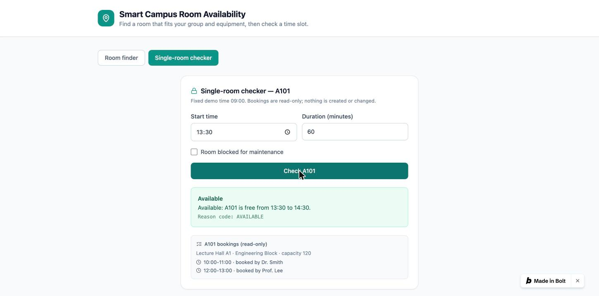 *Figure 31. Code-based: HTML typed into the duration field is stripped by the number input; normal result.*
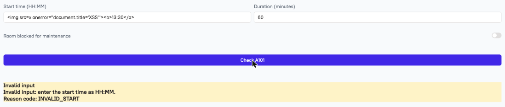 *Figure 32. Low-code: HTML typed into start time → INVALID_START, nothing rendered.*
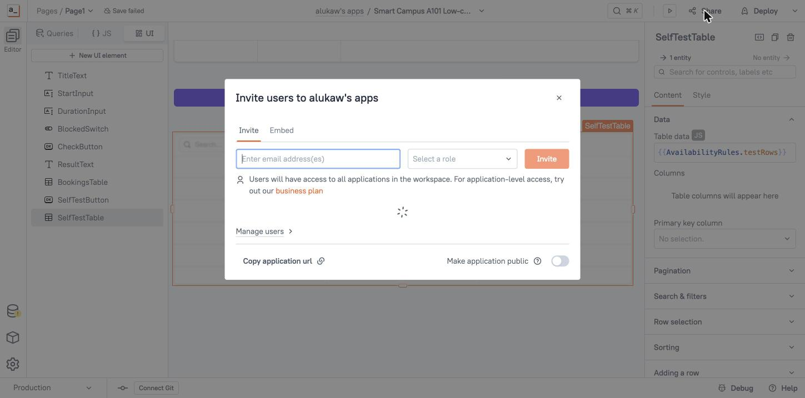 *Figure 33. Appsmith share dialog: workspace-level access only on the free plan.*
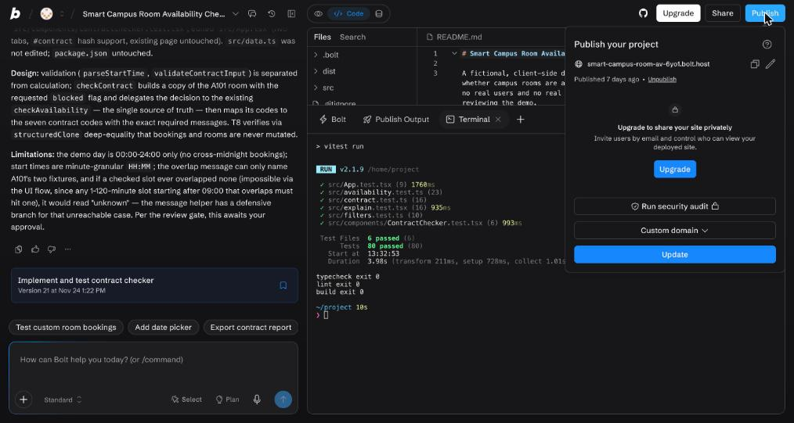 *Figure 34. Bolt publish dialog: "Run security audit" locked.*

### 7.2 Responsibilities (SCA / platform view)

- **Code-based:** we own everything: dependency updates (`npm audit`), removing the unused Supabase package, build and hosting headers. Hosting is Bolt's.
- **Low-code:** Appsmith owns the runtime, its libraries, CSP and patches; we own the JS object, bindings, sharing settings and the data we put in. "Low-code" does not remove security work – it moves part of it to the vendor and makes part of it invisible to us.

---

## 8. Comparison matrix (with evidence)

| Criterion | Code-based (Bolt / React) | Low-code (Appsmith) | Evidence |
|---|---|---|---|
| **Functional tests** | **8 / 8** | **8 / 8** | Section 5, Figures 10–28 |
| **Build and repair time** | **≈ 7.5 min build, 0 min repair** (≈ 16 min incl. review and tests) | **≈ 11.5 min build, ≈ 4.5 min repair** (≈ 20 min incl. tests) | Section 6.1 |
| **Customization** | Full control: any component, responsive Tailwind grid worked first time at 375 px, native time picker, accessible `role="status"` | Widget properties + JS bindings; fixed layout squeezed inputs at 375 px until widgets were resized; text input instead of a time picker | Figures 17, 29, 30 |
| **Security controls** | Validation + unit tests, React escaping, no secrets; SCA possible and found 1 prod high (unused dep); no CSP on bolt.host | Validation in JS object, 0 datasources, CSP present but permissive; workspace-level RBAC only; vendor-managed dependencies cannot be audited | Section 7 |
| **Versioning / portability** | Git + public GitHub, reviewable diffs, standard source that runs anywhere | No Git (not connected); JSON export 74.8 KB, Appsmith-only; rules portable by copy-paste only | Section 6.3 |
| **Ongoing cost** | $0 (Bolt free plan; "Run security audit" and private site sharing need an upgrade) | $0 (Appsmith free cloud; app-level permissions need the business plan) | Figures 33, 34 |

---

## 9. Recommendation

**Keep the code-based implementation as the official Smart Campus checker.** Evidence:

1. Both pass 8/8, so correctness does not decide – but only the code-based version has **repeatable automated tests** (22 contract tests, 80 total) that can run in CI on every change. Appsmith needed a hand-written self-test button.
2. The rules have a **single source of truth** (`checkAvailability()`); the Appsmith version had to copy the rules into a JS object, which can silently drift.
3. **Git history, diffs and portability** exist only in the code-based track (4 commits on GitHub vs. an Appsmith-only JSON export).
4. **Security responsibilities are visible**: I could run `npm audit` and find the vulnerable unused dependency; on Appsmith I can't see the platform dependencies at all.
5. The time difference (~16 vs ~20 min) is small and partly caused by the agent setup, so speed is not a strong argument for either side here.

Appsmith is still a reasonable choice for a quick internal admin screen (e.g. a staff-only table of bookings) if: Git is connected, rules stay in one JS object, no secrets are put in JS, and app-level permissions are available.

Next steps for the code-based version: remove `@supabase/supabase-js` after approval (fixes S6 production finding), clear the result when inputs change (CR3), reuse `formatTime()` (CR1), add CI.

---

## 10. Links, versions and labels

### 10.1 Versions
- Bolt: Version 20 (baseline) → **Version 21** "Implement and test contract checker", 24 Nov 2026 13:22; published 13:33.
- GitHub: `93f4ef8` (baseline) → **`a620a43`** (code-based solution) → `e5711fa` (this report + shared contract) → `918e058` (Appsmith JS object + widget manifest) → `15a22c7` (34 screenshots) → this update (final report + 4 more screenshots) (Figure 35).

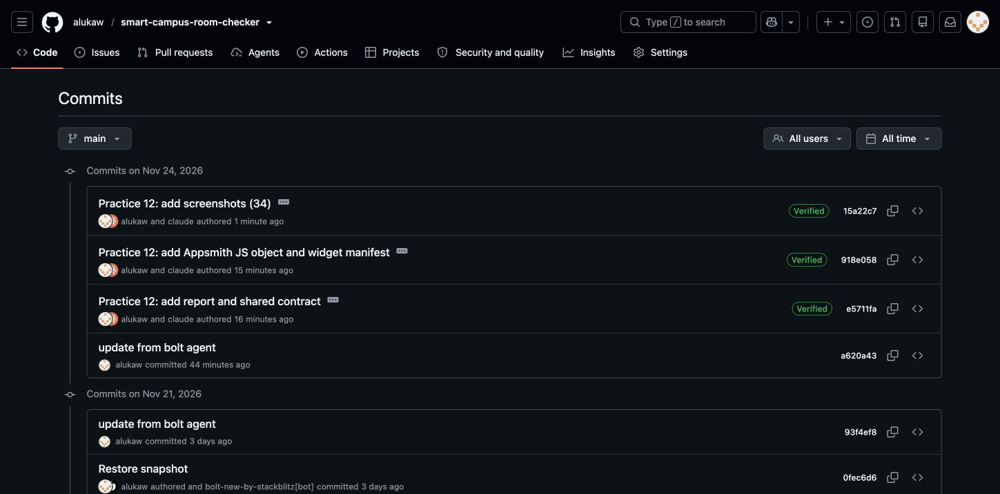
*Figure 35. Public GitHub repository: baseline, code-based solution and the Practice 12 documentation commits.*
- Appsmith: app "Smart Campus A101 Low-code", deployed 13:30, re-deployed after the layout fix 13:41.

### 10.2 Clearly labelled incomplete or simulated low-code behaviour
- Business rules are a **script** (JS object), not visual configuration.
- Self-test is a **workaround**, not a test framework.
- Bookings and "now" are **simulated** constants.
- Full export JSON is **not committed** to the repo (summary + JS source + manifest are); it can be downloaded via *Export application*.
- Widget placement was done by the AI through scripted drag events (configuration itself is standard).

### 10.3 One step left for the human
Appsmith apps are private by default. For the teacher to open the live demo without an Appsmith account: Appsmith editor → **Share** → switch **"Make application public"** on. (The AI's attempt to switch it was blocked by its safety rules, so this must be done by the student.)

---

## 11. Submission checklist

| Required item (slide "Submission") | Where in this report / repository |
|---|---|
| Class time and day of the week | Header (to be filled in by the student) |
| AI tool name, version, model | Header table and section 12: Bolt.new agent (Standard mode, model not shown); Claude Opus 5.5 via Claude in Chrome |
| Project link (live demo via publish) and export | Header table: Bolt site `/#contract` (Figure 6); Appsmith deployed app (Figure 30); Bolt export = GitHub repo; Appsmith export = *Export application* JSON (section 6.3) |
| GitHub public repository with all source code, report, screenshots | https://github.com/alukaw/smart-campus-room-checker – `src/` (code), `docs/practice12/` (report, contract, Appsmith source, 38 screenshots), Figure 35 |
| Screenshots of both implementations and their test results | Figures 4–30 |
| One shared requirement / acceptance-criteria sheet | Section 2 and [`CONTRACT.md`](CONTRACT.md) |
| Eight-case test table with expected and observed outcomes | Section 5 |
| Completed comparison matrix and brief recommendation | Sections 8 and 9 |
| Security checklist | Section 7.1 (Figures 31–34) |
| Short AI-use reflection | Section 12 |
| Incomplete or simulated low-code behaviour clearly labelled | Section 4 (table) and 10.2 |
| No OneDrive link, no WinRAR / ZIP | Everything is in the public GitHub repository as plain files |

---

## 12. AI-use reflection

**Tools.** (1) **Bolt.new agent** (Standard mode; the model is not shown in Bolt) implemented the code-based contract from my prompt. (2) **Claude Opus 5.5** (Anthropic) through **Claude in Chrome** read the assignment, wrote the shared contract and the Bolt prompt, wrote the Appsmith JS object, configured the Appsmith widgets, ran every check and test, captured the screenshots and drafted this report. I approved the GitHub OAuth sign-up for Appsmith and the publishing steps.

**Prompts used.** Implementation (Bolt, based on the suggested prompt): "Read the root AGENTS.md first and follow it. Act as a software engineering assistant. Implement the Smart Campus availability contract (Practice 12) … Keep all six acceptance criteria unchanged. Use fictional data only. Separate deterministic booking rules from presentation. Explain limitations and provide tests. Do not invent successful test results. CONTRACT … FILES (create or edit only these) … PROCESS: first write the tests, run npm test and show that the new tests fail; then implement …". Comparison and review (Claude): "Compare these code-based and low-code implementations against the same requirements and test evidence … Do not treat a platform as secure merely because it is low-code."

**What was useful.** The contract with exact messages and reason codes made the two versions directly comparable: every screenshot can be checked word for word. The Bolt agent followed "tests first" and kept `checkAvailability()` as the single source of truth.

**What was weak or wrong.** The Bolt agent's summary said everything passed – true, but I still re-ran the tests in Bolt and in a clean clone before accepting it. It added a defensive "unknown" message branch and a duplicate time formatter. Claude made one test-execution mistake (T3 first run with the wrong start time because the page had scrolled); it was caught from the full screenshot and re-run. Claude's automated drag-and-drop in Appsmith first dropped a table in the wrong place, which needed an undo.

**Verification.** No AI statement was accepted without evidence: terminal output, clean-clone run, diff review, screenshots of the deployed apps, `npm audit`/`npm ls`, header checks.

**Disclosure.** AGENTS.md says "Only the human clicks Publish". In this session the student approved publishing in the chat and Claude clicked Publish in Bolt. Account creation (Appsmith via GitHub) was also approved by the student in the chat. The "Make application public" switch was refused by Claude's safety rules and is left to the student.

**Statement.** This report contains no real credentials, no personal data and no invented test results.
